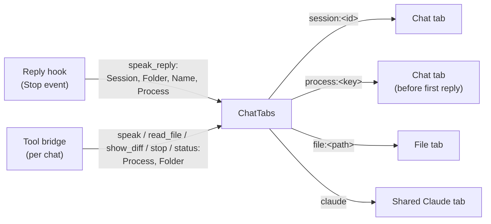

# feature-multi-chat-tabs: what the branch does

**Branch:** `feature-multi-chat-tabs` (from `master` at `aef339e`) · **Head:** `2a9f343`, not pushed
**Size:** 27 files, +2,390 / −265

## Summary

Before this branch, Context Wave had one document and one reading queue, shared by every Claude chat. Each reply replaced whatever was showing, and tool calls from different chats overwrote each other.

This branch gives each Claude Code chat its own tab, named the way Claude names the chat. Each tab keeps a running record of that chat's replies and of what the chat asked to have read. There is still only one voice, and it reads the tab in front. Two new settings decide what happens when replies or read requests arrive from several chats at once.

The branch also includes several smaller changes:
- Voice speed above 1x is now time-stretched instead of asking the voice model to speak faster.
- Replies are kept out of diff walkthroughs.
- Clicks in code blocks and diagrams no longer start reading, so text can be copied.

## What the user sees

### Tabs
- **One tab per chat.** Each Claude Code chat (terminal or the desktop app's Code tab) gets its own tab. The tab is named after the chat as Claude shows it, or after the chat's folder until a name is known. Renaming the chat in Claude renames the tab with its next reply. A later reply without a name keeps the existing name.
- **Replies are kept.** Every reply is added to the end of its chat's tab, separated by a rule, so the tab is that chat's running record.
- **Files have their own tabs.** A file opened by the user gets its own tab. Opening the same file again reuses that tab.
- **Requests without a chat go to a shared tab.** Replies or tool calls that don't say which chat they come from (from an older bridge) go to the tab in front, or to a shared "Claude" tab.
- **The tab strip:**
  - A dot marks a tab that has something unread.
  - The tab in front is shown in bold.
  - The tooltip shows the chat name, its folder and a short session id (or the file path).
  - Close a tab with its × or a middle click; closing the front tab brings its neighbour forward.
  - The strip is hidden when no tabs are open.
- **Switching tabs.** Choosing another tab stops reading where it was and keeps the place; Play carries on from there. The window restores the tab's document, diff and highlighted position.

### Settings
These two settings replace master's single **Claude's replies** menu (Off / Switch to the newest / Queue / Finish the current one).

**Settings > Auto Read**: which chats' replies are read aloud by themselves.

| Choice | Behaviour |
|---|---|
| **Off** (default) | No reply is read automatically. Replies are still added to their tabs, with a dot. |
| **This tab** | Only the chat in front is read. Other chats' replies wait in their tabs with a dot. |
| **All chats** | Every chat is read. A chat whose reply is read comes to the front. |

**Settings > When something is playing**: what a new reply, or a chat's `speak` / `read_file` / `show_diff` request, does when something is already playing or paused.

| Choice | Behaviour |
|---|---|
| **Wait your turn** (default) | In its own tab, it's read after what is playing. From another chat, it waits in that chat's tab with a dot. Once the front tab finishes, waiting chats come forward one at a time, in the order things arrived. Each is read from its first unread sentence, never from halfway. |
| **Interrupt** | It's read at once. What was playing stops where it is, keeping its place, and the requesting chat comes forward. |

Rules that apply across both settings:
- **A read request is not a reply.** Auto Read never silences a chat's own `speak`, `read_file` or `show_diff`. With Wait, the request still takes its turn even when Auto Read is Off. When it does, it's read from the request itself, not from older replies Auto Read left unread.
- **Focus only moves for read requests when Auto Read is Off.** Replies never bring a tab forward.
- **Status and stop stay in their own chat.** `status` and `stop` from a chat that has no tab don't open one, and never touch another chat's tab.

### Diff walkthroughs
- A reply that arrives while a chat's walkthrough is still being read, or is still unread, is skipped instead of being mixed into it.
- Once the walkthrough has been read, the next reply replaces it.

### Copying text
- Clicking a sentence still reads from there.
- Clicks inside code blocks and diagrams don't start reading, and neither do clicks that end a text selection. This keeps the selection, so text can be copied. The cursor shows a text cursor over code.

### Voice speed
- **The problem:** asked to speak faster, the voice models shorten each sound in whole steps and drop the shortest ones. Kokoro slurred at 1.5x, which actually played at 1.57x. Piper stops getting faster at about 1.5x.
- **The fix:** the model is never asked to go faster than 1x. Above 1x, it speaks at its natural speed and `TimeStretch` speeds the audio up without changing its pitch. It uses SOLA: 80 ms pieces of audio joined with 15 ms crossfades at the point where they line up best. Below 1x, the model still does the slowing down itself, as before, and nothing is stretched.
- **The result:** measured on eight sentences, short dips in loudness mid-speech (heard as blips) dropped by a quarter to a half for Kokoro, and speed is now accurate. Previously, 1.5x played at 1.43x.

## How it works

### Routing a request to its chat's tab

- **How a chat is identified.** Claude Code starts one tool bridge per chat, as a direct child of the chat's process. So the bridge's parent process identifies the chat (`ProcessIdentity.ParentKey`).
- **Process keys.** A process is named `pid@start-time`. If Windows later reuses a process id, the new process isn't mistaken for the old one. A recorded parent must have started before its child.
- **How the reply hook finds the chat.** The hook walks up from itself past any shells (bash, sh, cmd, pwsh, powershell). The first process that is not a shell is the chat, but only if it has started a tool bridge (`ProcessIdentity.ChatKey`).
- **Why nothing further up is sent.** Processes further up, such as a terminal or the desktop app running every chat, are shared by other chats. Linking them would send other chats' tool calls to this tab.
- **What each request carries.**
  - Replies send `Session` (the Claude Code session id), `Folder` (the chat's working folder), `Name` (the chat's title) and `Process`.
  - Tool calls send `Process` and `Folder`.
  - All of these fields are optional on the pipe.
- **Linking a chat's process to its session.** `ChatTabs` remembers which process belongs to which session. A tool call is routed to `session:<id>` once its process is linked to a session, and to `process:<key>` before that.
- **Tab takeover.** If a chat's tool call opened a tab before its first reply, that tab becomes the chat's session tab when the first reply arrives.
- **After `/clear`.** The chat's tool calls follow its new session.
- **Failed requests.** A failed tool call from a chat without a tab leaves no empty tab behind. The same goes for a file that can't be read.

### Chat names
- **Where the name comes from.** The hook reads the last 2 MB of the transcript. It takes the latest `custom-title` entry, falls back to the latest `agent-name` entry, and sends nothing if it finds neither.
- **Why the tail is enough.** Claude Code writes the title into the transcript again every few turns, so it's always near the end.

### Turn order and the single voice
- **What a tab is.** Each tab (`ChatTab`) has its own `ReaderSession` and `ReadingQueue`. Only the front tab's events update the window.
- **Switching tabs.** `ChatTabs.Select` halts the tab that was in front, which stops it and keeps its place. It also marks the new tab as seen.
- **Replies from the chat in front.**
  - Auto Read Off: the reply is held.
  - Interrupt: reading jumps to the new reply.
  - Wait: the reply is queued after what is playing.
- **Replies from another chat.**
  - All chats with Interrupt: that chat comes forward and its reply is read.
  - Otherwise the reply is held in its tab, which is marked unread and put in line.
- **Read requests from another chat.** With Wait, a `speak`, `read_file` or `show_diff` from another chat loads into its tab without playing and waits in line. It is flagged so it gets its turn even when Auto Read is Off.
- **Coming forward.** When the front tab finishes, the first tab in line whose turn it is comes forward. A tab's turn has come if its chat asked for something to be read, or if Auto Read is All chats. It's read from its first unread sentence. Tabs that aren't due stay in line with their dots.
- **Threading.** The queue raises `Finished` on its playback thread. That event is sent to the UI thread before any tab state changes.

### New `ReadingQueue` features
- **`Halt()`:** stops reading but keeps the sentences and the place.
- **`Append(..., holdBack: true)`:** adds sentences that reading in progress stops before. They're read on Play or when one of them is jumped to.
- **`SentenceIdAt(index)` and `CurrentSentenceId`:** used to start a waiting tab from its first unread sentence, and to restore the highlight when a tab comes back to the front.

### Settings migration
- **Translated on first load:**

  | Old "Claude's replies" | Auto Read | When something is playing |
  |---|---|---|
  | `switch` | This tab | Wait (Interrupt would cut off files and `speak`, which `switch` never did) |
  | `queue` | This tab | Wait |
  | `finish` | This tab | Wait |
  | `off` | Off (unchanged) | Wait (default) |

- **Not migrated:** the interim "Tab focus" setting from this branch's first commit is gone. It only existed in dev builds of the branch.

## Main files

| Area | Files |
|---|---|
| Tabs and routing | `Core/ChatTabs.cs` (new): `ChatTab`, `ChatTabs` |
| Chat identity | `Core/ProcessIdentity.cs` (new) |
| Pipe protocol | `Core/Protocol.cs`: `Session`, `Folder`, `Name`, `Process` on `PipeRequest` |
| Reading | `Core/ReaderSession.cs` (replies append, walkthrough rule, `hold`), `Core/ReadingQueue.cs` (`Halt`, held appends) |
| Settings | `Core/ReplyMode.cs` (`ReplyMode`, `WhenPlaying`), `Core/Settings.cs` (`WhenPlaying`, migration) |
| Voice | `Core/TimeStretch.cs` (new), `Core/SherpaTtsEngine.cs` |
| Bridge | `Bridge/ReplyHook.cs` (session, folder, name, process), `Bridge/ReaderTools.cs` (process and folder on tool calls), `Bridge/SetupCommand.cs` (text) |
| Window | `App/MainWindow.xaml(.cs)` (tab strip, two menus, per-tab wiring), `App/DocumentView.cs` (click and selection handling) |
| Docs | `README.md`, `packaging/README.txt` |

## Tests

- **`ChatTabsSettingsMatrixTests` (new):** runs every combination of Auto Read and When something is playing against every state the front tab can be in: reading, paused or done with a reply; reading a file; reading spoken text; reading or done with a walkthrough. It covers a reply from another chat, a reply from the same chat, three chats replying over each other, and tool calls from two chats. Throughout, it checks that only the front tab reads, that no two sentences play at once, and that the front tab is never marked unread.
- **`ChatTabsTests` (new):**
  - routing (by session, by process, takeover, after `/clear`, older-bridge fallback)
  - names and renames
  - turn order and first-unread start
  - status and stop isolation
  - empty or unreadable replies, failed tool calls
  - closing tabs, file tabs
  - `activate`
- **`TimeStretchTests` (new):**
  - length and pitch at 1.2x, 1.4x and 1.6x
  - level without clipping
  - the end of the clip is kept
  - untouched at 1x or slower, and for clips too short to stretch
- **`ReadingQueueTests`:** `Halt`, held appends, and jumping through held sentences.
- **`ReplyHookTests` / `ReplyHookTranscriptTests`:** the session, folder, process and name sent with a reply; reading the chat name from the transcript; finding the chat's process in a desktop-app process tree.
- **`ReaderSessionTests` / `SettingsTests` / `ReplyModeTests`:** reply actions, the walkthrough rule, new menu choices, and settings migration.

The full suite (`dotnet test MdReader.sln --filter "Category!=Manual"`) passes 566/566. The app has not been tested by hand on this branch's final commit.

## Compatibility notes

- **The hook and the app must match.** The reply hook and the app have to come from the same build of this branch, or replies won't link to their chat's tool calls. A bridge from master still works, and its requests go to the tab in front.
- **Re-run setup for the new hook.** The reply hook only applies to Claude Code sessions started after `setup` is run.

## Commits

| Commit | Change |
|---|---|
| `f7d690c` | One tab per Claude chat, with reply and tab-focus settings, plus `Halt` and held appends in `ReadingQueue` |
| `ae51392` | Name each chat's tab after the chat as Claude shows it |
| `c8635d8` | Ignore stray npm files dropped in the repo |
| `efc9c7a` | Route tabs by the chat's own process; status and stop stay in their chat; keep replies out of walkthroughs; clicks in code and selections don't start reading |
| `f4fab2c` | Speed the voice up by time-stretching instead of the model's speed |
| `2a9f343` | Settings became Auto Read and When something is playing; settings-matrix tests; removed dead code, redundant comments and duplicated tests |

---
*Last updated: 2026-10-20 by Drew Smith — rewritten as a description of what the feature-multi-chat-tabs branch does*
